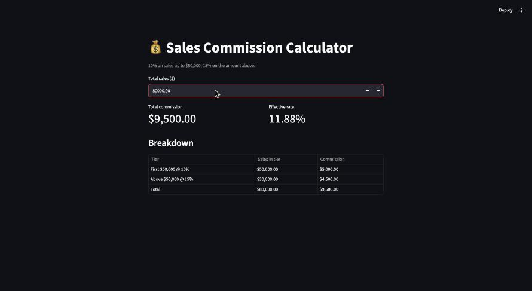
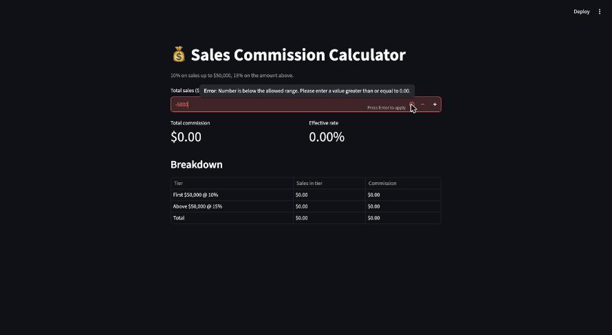
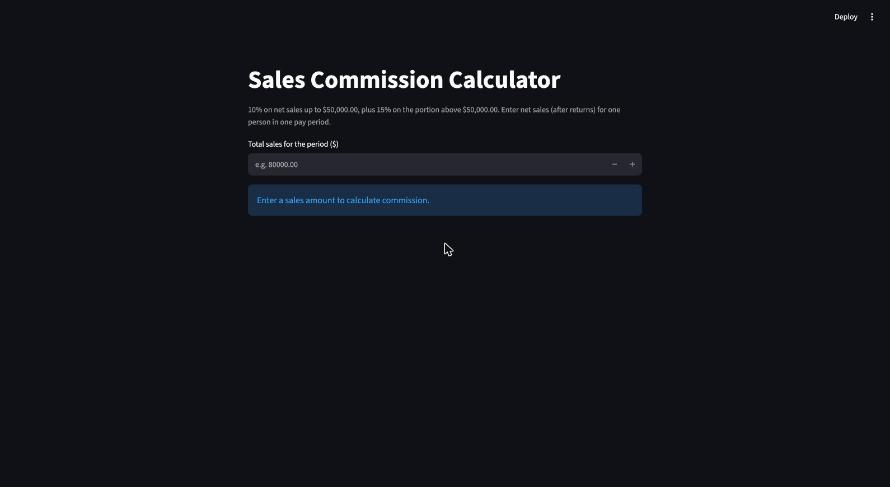
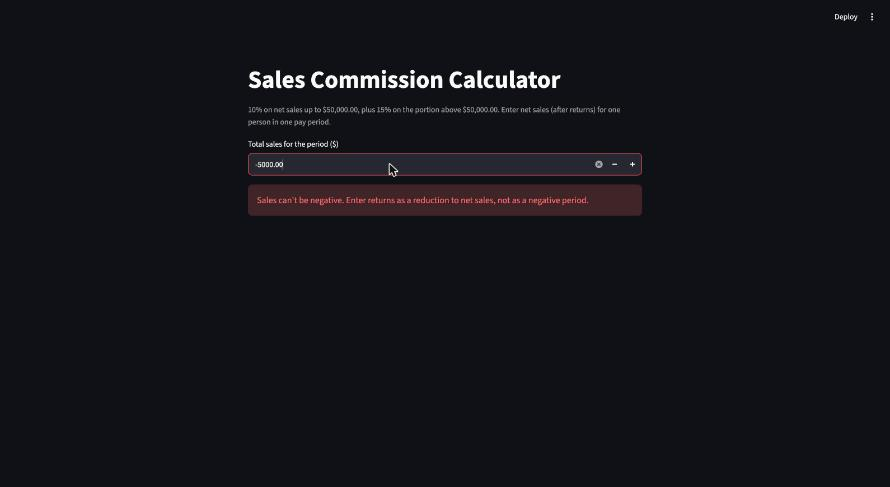
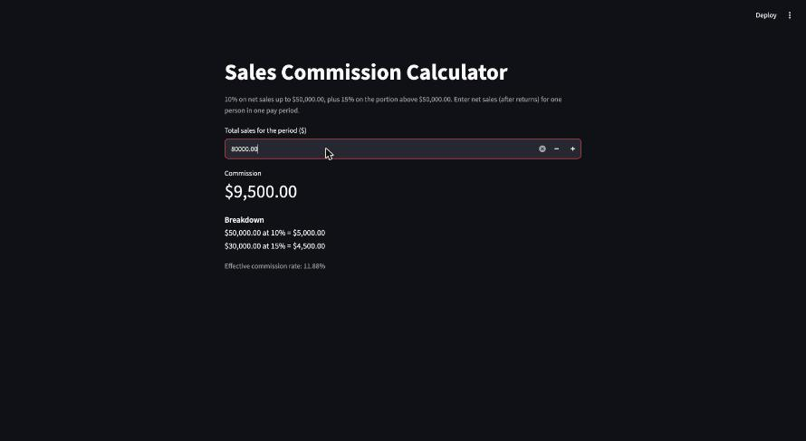

# Commission App — In-class Activity 15

**Vibe Coding: How Will You Know What You Don't Know?** · OIM 3641 · Alexander Kozin

A Streamlit sales commission calculator built two ways: first from a one-sentence prompt, then
from a written spec. The repo history has both versions: commit **"One-shot version"** and
commit **"Spec version"**.

```bash
cd activities/commission-app
uv sync
uv run streamlit run app.py
```

**AI used:** Claude, in a fresh chat with no tools and no project files (so it couldn't run
anything, the same as pasting into ChatGPT). The one-shot build and the five Part 4 questions
were one conversation. The spec rebuild was a new conversation.

---

## Part 1: Warm-up — fix two bad prompts

### 1. "My app is broken."

**Revised:**

> My Streamlit app (Python 3.15, Streamlit 1.66, run with `uv run streamlit run app.py`) crashes
> when I click "Calculate" after entering a sales amount. I expected it to show the commission.
> Instead I get this error:
>
> ```
> TypeError: '<' not supported between instances of 'str' and 'float'
>   File "app.py", line 14, in calculate_commission
> ```
>
> Here's `app.py`: *[paste code]*. It worked before I switched the input from `st.number_input`
> to `st.text_input`. What's causing this, and what's the smallest fix?

**What the AI needed that the original left out:** what the app is and what it's built with
(language, framework, versions, how it's run); what "broken" means (crash, wrong answer, won't
start); the exact error message and traceback; expected vs. actual behavior; the steps to
reproduce it; the relevant code; what changed recently; and what kind of answer I want (a
minimal fix vs. a rewrite).

### 2. "I need to parse a dataset."

**Revised:**

> I have a 40 MB CSV export from Salesforce (`opportunities.csv`, about 120,000 rows, UTF-8 with a
> header row). Columns include `Close Date` (MM/DD/YYYY), `Amount` (text like "$12,500.00", some
> blank), and `Stage`. Using Python and pandas, load it so `Close Date` is a real date and
> `Amount` is a float, drop rows where `Stage` is "Closed Lost", and give me total `Amount` by
> month. Here are the first five rows: *[paste sample]*. Blank amounts should count as 0. Return a
> short script I can run.

**What the AI needed that the original left out:** the file format and size; where the data
comes from; the columns and their types, especially messy ones (dates, currency stored as text,
blanks); a sample of real rows; the tool or language to use; what "parse" means (load, clean,
filter, summarize?); how to handle missing or bad values; and what the output should be.

---

## Part 2: One-shot build

We created the project with `uv init commission-app` and `uv add streamlit`, then gave the AI
exactly this and nothing more:

> Build a Streamlit sales commission calculator in Python: 10% on sales up to $50,000, 15% above.

It returned a 68-line app. We saved it as `app.py`, ran it with `uv run streamlit run app.py`
(it worked the first time) and committed it as "One-shot version."

Worth noting: the AI said up front that it chose the **tiered** reading (15% only on dollars
above $50,000) and showed how to switch to the flat one. Not every AI flags this. Many silently
pick one.

---

## Part 3: Predict, then test

### Predictions (done by hand, before using the app)

Two readings of "10% up to $50,000, 15% above" are both defensible, so we predicted both:

- **Tiered (marginal):** 10% on the first $50,000, 15% only on the part above. Works like tax
  brackets.
- **Flat:** whatever bracket your total lands in, that rate applies to *all* of your sales.

| Sales | Predicted (tiered) | Predicted (flat) | App's answer | Match? |
| --- | --- | --- | --- | --- |
| $40,000 | $4,000.00 | $4,000.00 | $4,000.00 | ✅ |
| $50,000 | $5,000.00 | $5,000.00 | $5,000.00 | ✅ |
| $50,001 | $5,000.15 | $7,500.15 | $5,000.15 | ✅ tiered / ❌ flat |
| $80,000 | $9,500.00 | $12,000.00 | $9,500.00 | ✅ tiered / ❌ flat |
| $0 | $0.00 | $0.00 | $0.00 | ✅ |
| –$5,000 | Not allowed (error) | Not allowed (error) | Field turns red, the result stays at the old value ($0.00) | ⚠️ partial |

**Where the predictions split, and why:**

- **$50,001 and $80,000:** tiered gives $5,000.15 / $9,500. Flat gives $7,500.15 / $12,000.
  "15% above" can mean "15% on the amount above $50k" or "15% once you're above $50k."
- **–$5,000:** pure math gives –$500 (a clawback), but a negative *period* of sales isn't a
  real thing. Returns should reduce net sales, not be entered on their own. We predicted "the app
  should refuse it with a message."
- **$50,000 exactly:** "up to $50,000" includes $50,000, so 10%. Under the tiered reading it
  doesn't matter, but under the flat reading $50,000 vs. $50,001 is a $2,500 swing.

### Testing the one-shot app

The app computed the tiered answer for every positive amount, plus a 10.00% effective rate. For
–$5,000, the input box has `min_value=0`, so Streamlit turns the box red and refuses the value.
The only explanation is a tooltip ("Number is below the allowed range"), which you see only if
you hover over a small icon. The commission still shows **$0.00** from before, so a user who
doesn't hover could think –$5,000 earns $0.

| One-shot: $80,000 | One-shot: –$5,000 (hovering over the error icon) |
| --- | --- |
|  |  |

**Where does the app disagree with us? Is the app wrong, or is the spec unclear?**
The app matches our tiered predictions, so it's only "wrong" if the business meant the flat
model. That's the spec's fault, not the app's: one sentence supports two very different pay
plans. The negative case is a real app weakness. It rejects the value without a visible
message and leaves the old result on screen.

**Is there more than one reasonable answer for $80,000?** Yes:
- **Tiered:** $50,000 × 10% + $30,000 × 15% = $5,000 + $4,500 = **$9,500**
- **Flat:** $80,000 × 15% = **$12,000**

**$50,000 vs. $50,001 under each interpretation:**

| | $50,000 | $50,001 | Difference for one extra dollar of sales |
| --- | --- | --- | --- |
| Tiered | $5,000.00 | $5,000.15 | +$0.15 |
| Flat | $5,000.00 | $7,500.15 | **+$2,500.15** |

- **Salesperson:** wants **flat**. It pays more at every level above $50k, and that one extra
  dollar is worth $2,500.
- **Sales manager:** wants **tiered**. It costs less, and it avoids the "cliff." Under the flat
  plan, reps sitting just under $50k will pull deals forward, split them, or hold them to land
  just over the line. The cliff rewards gaming the threshold, not selling more.

---

## Part 4: Interrogate the code

| # | Question | AI's answer (short) | What we learned |
| --- | --- | --- | --- |
| 1 | What did you assume that I didn't tell you? | Tiered rather than flat; $50,000 counts as "up to"; sales are one person's per-period total; no negative sales (returns can't be entered); USD with no explicit rounding rule; added extras we didn't ask for (effective rate, breakdown table, $1,000 step); rates hard-coded; no caps or bonuses. | The one sentence left a lot out. The tiered/flat choice is the big one, but "what period?" and "gross or net sales?" also change the pay. The AI quietly filled each gap. |
| 2 | Explain it part by part. | Constants at the top; `calculate_commission` splits sales into two buckets with `min(sales, 50000)` and `max(sales − 50000, 0)`; returns a dict so the UI can show a breakdown; `number_input` with `min_value=0`; Streamlit reruns the whole script on every input change; metrics and a table display the result. | The `min`/`max` trick *is* the tiered rule, with no `if` statement. Also, Streamlit has no "Calculate" button logic: the whole file reruns top to bottom whenever you change the number. |
| 3 | What happens with empty, wrong or huge input? | Blank: reverts to the last value, so you can't tell "not entered" from $0. Letters: blocked by the widget. Negative: blocked by the widget, but the *function* itself would happily return –$100 for –$1,000. $10 billion: computes $1,499,997,500 correctly; no typo guard; floats are fine at that size. | The protection lives in the widget, not the math. Anyone who reuses `calculate_commission` (in a payroll script or a test) gets negative commissions. The blank case also makes "missing" look like "$0." |
| 4 | What did you leave out? | It never ran the code. Predicted an extra index column in the table. Rounded rows might not add to the rounded total. A *pair* of `$` signs in Streamlit Markdown renders as LaTeX math. A $0 effective rate is meaningless. No rounding policy (Python's `f"{2.675:.2f}"` gives `2.67`). NaN/infinity/string inputs to the function. No threshold reset period, gross vs. net, or taxes. No tests or requirements file. | One claim was **wrong**: our screenshot shows no index column. The AI said it hadn't run the code, and it was right to warn us. Its other points held up: we checked `f"{2.675:.2f}"` in Python and got `2.67`. |
| 5 | Is there a simpler way? | Yes, about 8 lines: one `number_input`, one line of math, one `st.metric`. Or a plain `if/else` (`5_000 + (sales − 50_000) × 0.15` above the threshold). You lose the breakdown and testability. | Much of the 68 lines was presentation the prompt never asked for. The core logic is one line. Simpler is easier to check, but separating the math into a function is what makes it testable. |

**Something we'd never have known to ask about:** the `$` sign in Streamlit text. `st.caption`,
`st.title`, `st.markdown` and widget labels all treat text as Markdown, and Streamlit's Markdown
renders anything between two dollar signs as a LaTeX math formula. So a caption like
"10% on sales up to $50,000, 15% above $50,000" would render the middle part as italic math
symbols with the dollar signs gone. The one-shot app got lucky: its caption has only one `$`.
In a money app, dollar signs are everywhere, and the fix (`\$`) isn't something you'd think to
look for. We put it in the spec, and the rebuilt app escapes every dollar sign in Markdown text.

---

## Part 5: Rebuild from a real spec

### Our decision

We chose **tiered (marginal)** commission. It has no cliff at $50,000, so every extra dollar of
sales earns either 10 or 15 cents and there's no reason to time or split deals around the
threshold. It's also how the AI and most real plans read "X% up to, Y% above." We also decided
that sales means **net sales for one person in one period**, that negatives get a clear error
(returns reduce net sales, they aren't a negative period), and that blank must look different
from $0.

### The spec we gave the AI

The full prompt is saved in [`spec.md`](spec.md). In summary:

- **Input:** one `st.number_input`, starting blank (`value=None`); valid range $0.00–$10,000,000.00
  in dollars and cents; no `min_value`, so the app can explain negatives itself.
- **Rule:** `commission = 0.10 × min(sales, 50,000) + 0.15 × max(sales − 50,000, 0)`; explicitly
  *not* the flat model; computed with `Decimal` and rounded to the cent (half-up); the math in a
  pure `calculate_commission` function that raises `ValueError` on negatives.
- **Edge cases:** blank → info message and no number; $0 → $0.00 with no effective rate;
  negative → error message and no number; over $10M → error asking to double-check.
- **Output:** a `Commission` metric plus a two-line breakdown; escape `$` as `\$` in Markdown.
- **Worked examples it must match:** the six amounts from Part 3, plus blank.

### Verification

The rebuilt app matched every prediction on the first try. We checked all of these in the
browser and with Streamlit's `AppTest`:

| Sales | Predicted | Spec app's answer | Match? |
| --- | --- | --- | --- |
| $40,000 | $4,000.00 | $4,000.00 | ✅ |
| $50,000 | $5,000.00 | $5,000.00 | ✅ |
| $50,001 | $5,000.15 | $5,000.15 | ✅ |
| $80,000 | $9,500.00 | $9,500.00 | ✅ |
| $0 | $0.00 | $0.00 | ✅ |
| –$5,000 | Error, no commission | "Sales can't be negative. Enter returns as a reduction to net sales…" and no number | ✅ |
| Blank (extra) | Prompt, no commission | "Enter a sales amount to calculate commission." | ✅ |
| $20,000,000 (extra) | Over-limit error | "$20,000,000.00 is over the $10,000,000 limit…" | ✅ |

| Blank | –$5,000 | $80,000 |
| --- | --- | --- |
|  |  |  |

### What changed (`git diff HEAD~1`)

`app.py`: 166 lines added, 66 removed. The most important differences:

1. **Negatives and blanks are handled out loud, not silently.** The one-shot app relied on
   `min_value=0` and `value=0.0`. A negative was quietly rejected while the old answer stayed on
   screen, and a blank looked the same as $0. The spec version drops `min_value`, starts at
   `value=None`, and shows a specific `st.info` or `st.error` with no commission number. The
   rule also lives inside `calculate_commission`, which now raises `ValueError` for negative
   sales, so the math is safe even outside the UI.
2. **Money math uses `Decimal` with an explicit rounding rule.** The one-shot used floats and
   relied on `:,.2f` formatting to hide errors. The spec version converts the input with
   `Decimal(str(value))` and rounds to the cent with `ROUND_HALF_UP`, the way payroll does it.
3. **The business decisions are written into the code.** The docstring and caption now state
   *tiered*, *net sales*, *one person, one pay period*, and the $10M sanity limit. A reader no
   longer has to guess which interpretation the code implements. Dollar signs in Markdown are
   escaped as `\$`.

---

## Part 6: Reflect

**What didn't you know to ask the first time? How did you find out?**
We didn't know the one sentence described two different pay plans until we did the predictions
by hand. Writing down $80,000 forced us to choose between $9,500 and $12,000, and the sentence
doesn't say which is "right." The rest came from interrogating the AI: what period the threshold
covers, gross vs. net sales, whether returns can be entered, what a blank box means, how to round
cents, and the Streamlit `$`-as-LaTeX trap. None of those were on our radar. We only found them by
asking "what did you assume?" and "what did you leave out?" and then checking the answers. One
answer turned out to be wrong (the index column), which is its own lesson.

**The one-shot app ran without errors. Why wasn't that enough?**
"Runs without errors" means the Python is valid, not that the business rule is the one we want.
The one-shot app gives a confident, nicely formatted $9,500 for $80,000. If the company meant the
flat plan, that's a $2,500 underpayment on every such paycheck, and nothing on screen would tell
you. It also quietly mishandled the edges: a negative entry left the old result showing, and a
blank looked the same as $0. A program can be error-free and still wrong. Only comparing it with
answers we worked out ourselves showed us which kind it was.

**When would pure vibe coding be good enough?**
When being wrong is cheap, obvious, and easy to undo: a throwaway prototype to show an idea, a
personal script whose output you can eyeball, a UI mockup, or exploring a new library. It's also
fine when the result is checked downstream anyway, like a chart you'll look at before sharing. It
isn't good enough when the code moves money, makes decisions about people, handles private data,
or will be reused by someone who trusts it without reading it. A commission calculator does all
of those. The more the output is acted on without a human checking it, the more you need a spec,
predicted answers, and tests.
